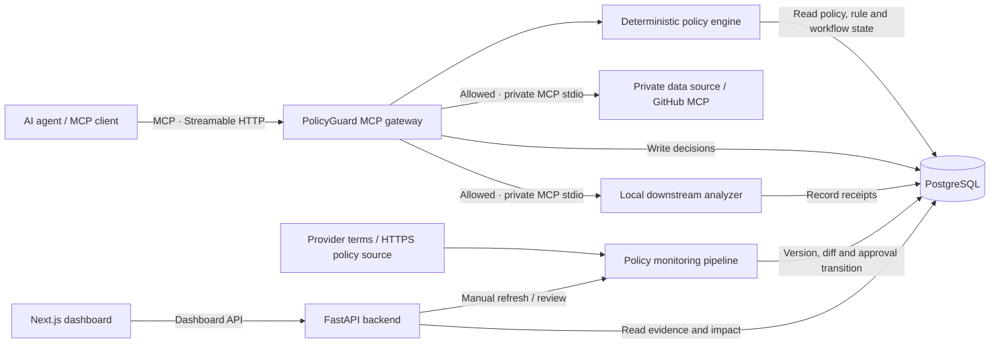
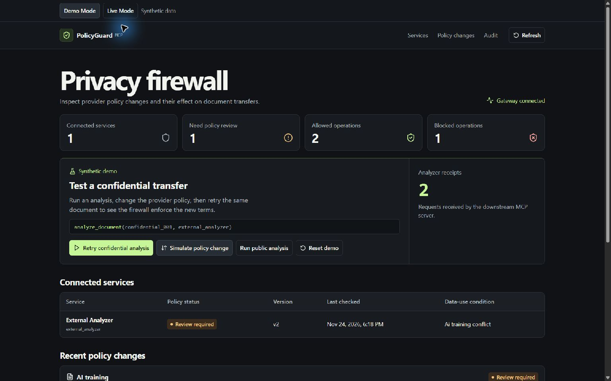
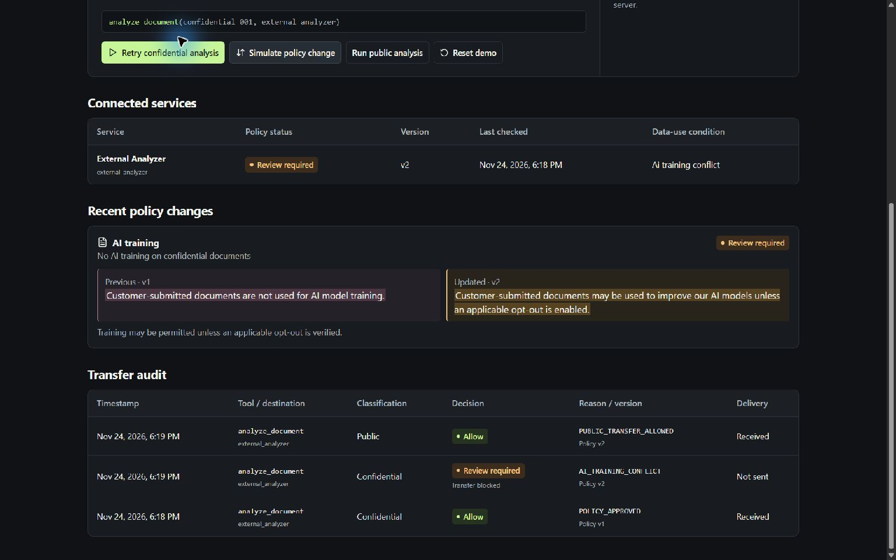

# PolicyGuard MCP

**Turning changing privacy policies into enforceable AI-agent permissions.**

Built for **wHACKiest 2026** · **Make MCP Matter — Less Magic, More Utility**

An AI agent may have permission to send confidential data to a provider. If that provider changes its privacy terms, a static permission list can keep allowing transfers under an outdated approval. PolicyGuard tracks the terms a workflow relies on and uses the current policy state to decide whether an MCP transfer can proceed. In the verified Live run, an observed clause change blocked the same confidential request without a gateway restart or an additional analyzer receipt.

## What works

- **Policy monitoring** fetches allowlisted HTTPS terms, stores normalized versions, and records changes with source URLs and timestamps. Open Terms Archive imports provide historical context.
- **Policy interpretation** uses deterministic extraction by default. An optional LLM can help interpret public policy excerpts. It cannot approve a provider or decide a transfer. The optional real model API has not been verified.
- **Automatic enforcement** invalidates the applicable confidential approval when the monitored destination policy changes. An eligible public workflow can remain allowed.
- **Real MCP integrations** connect the Live gateway to the official GitHub MCP server with scoped read-only access and to a local analyzer. The approved and blocked cases were verified against independent analyzer receipts.
- **Separate Demo and Live environments** use separate PostgreSQL databases, roles, and endpoints. Demo uses a synthetic fixture and can run without GitHub credentials.
- **Privacy Blast Radius Analysis** identifies affected workflows, shows the policy and rule behind each decision, and links historical review candidates to prior audit records. Candidates are records to review.
- **Policy evidence and audit** retain version identifiers, decisions, delivery states, and the observed change when it caused a restriction.

## Architecture



**Policy monitoring.** A scheduled or authenticated manual refresh fetches the terms, compares normalized content, and stores the new version and evidence. A relevant or ambiguous monitored change moves the destination’s confidential approval to review. Historical archive imports remain separate from active enforcement.

**MCP enforcement.** The gateway resolves the registered resource, classification, source, and destination from trusted configuration. The policy engine evaluates the applicable organization rules and version-specific approvals before retrieving the body. An allowed transfer goes to the analyzer over MCP. The analyzer stores a receipt and the gateway stores a separate audit decision.

## Screenshots / Product Preview

**Dashboard and mode selector.** Demo Mode shows the synthetic workflow, gateway status, and downstream analyzer receipts.



**Policy comparison and transfer audit.** Demo Mode highlights the change from v1 to v2. The audit shows the confidential transfer held after the policy change and the public transfer allowed under v2.



## Quick start

Prerequisites are Git, Python 3.12+, [uv](https://docs.astral.sh/uv/), Node.js 24 with npm, and Docker with Compose. Live additionally needs the official GitHub MCP server and a fine-grained token with **Contents: Read** for the designated fixture repository. The controlled local HTTPS fixture uses OpenSSL.

### 1. Clone and install

Run from PowerShell. On Linux or WSL, use `cp` instead of `Copy-Item`, `npm` instead of `npm.cmd`, and Bash environment syntax.

```powershell
git clone -b feature/live-integrations https://github.com/binarybranch30/Privora.git
cd Privora
Copy-Item .env.example .env
docker compose up -d --wait
uv sync --locked --python 3.12
uv run alembic upgrade head
npm.cmd ci --prefix frontend
```

The supplied Compose database listens locally on port `55439`. The Demo backend reads `DATABASE_URL` and `DEMO_MODE` from `.env`. For a Docker-free Demo, use `DATABASE_URL=sqlite:///./policyguard.db` before applying migrations.

### 2. Start Demo and the dashboard

Use separate terminals from the checkout root.

```powershell
uv run uvicorn policyguard.api:app --host 127.0.0.1 --port 8000
```

```powershell
npm.cmd --prefix frontend run dev -- --hostname 127.0.0.1
```

Open the [dashboard](http://127.0.0.1:3000), choose **Demo Mode**, and click **Reset demo** to seed it. The FastAPI process also serves the Demo MCP gateway at `http://localhost:8000/mcp/`. To verify the synthetic sequence and its receipts:

```powershell
uv run python -m scripts.verify_demo
```

This command resets Demo data. The gateway starts the downstream MCP servers as private stdio subprocesses. For standalone MCP inspection, use `uv run python -m policyguard.downstream documents` or `uv run python -m policyguard.downstream analyzer`.

### 3. Add Live Mode

Follow the [Live setup guide](docs/LIVE_SETUP.md) to create scoped database roles and copy `.env.live.example` to the ignored `.env.live`. Configure `LIVE_DATABASE_URL`, `LIVE_ADMIN_SECRET`, `LIVE_MCP_SECRET`, the policy allowlist and GitHub connector settings. For the fictional analyzer, configure its policy URL and dedicated development certificate as described in the [final demo runbook](docs/FINAL_DEMO_RUNBOOK.md). Keep the credentials out of Git.

```powershell
$env:POLICYGUARD_LIVE_CONFIG = '.env.live'
uv run python -m policyguard.live_setup migrate
uv run uvicorn policyguard.live_api:app_factory --factory --host 127.0.0.1 --port 8001
```

Choose **Live Mode** in the same dashboard and sign in with the local Live admin secret. Live MCP clients connect to `http://localhost:8001/mcp/` with their separate bearer credential. Keep both backends on loopback with one worker per instance.

## Demo walkthrough

The [final demo runbook](docs/FINAL_DEMO_RUNBOOK.md) contains the commands, safe fixture reset, expected output, and troubleshooting.

1. The official GitHub MCP server reads a synthetic file classified as **CONFIDENTIAL**. The v1 fictional analyzer policy is approved, so the local analyzer receives it and records a receipt.
2. The controlled HTTPS endpoint changes its wording from prohibiting training on submitted documents to allowing model improvement unless an opt-out applies.
3. **Refresh policy** observes v2, stores the clause comparison and automatically invalidates the applicable approval.
4. The identical confidential request returns `REVIEW_REQUIRED / AI_TRAINING_CONFLICT / NOT_SENT`. Its request ID has no analyzer receipt, and the receipt total stays at **3** in the recorded run.
5. A separately classified public request remains allowed. **View blast radius** shows the affected confidential workflow, unaffected public workflow, and prior delivery to review.

## Verification

| Check | Confirmed result |
| --- | --- |
| Backend suite | 11 passed on SQLite and 11 passed on PostgreSQL |
| Frontend | Lint and production build passed |
| Credentialed GitHub MCP | Nine-word confidential fixture delivered under approved v1 |
| Automatic restriction | Identical retry held after the ordinary v2 refresh, with no gateway restart and no additional receipt |
| Isolation | Live request IDs absent from Demo audit |
| Blast radius | One affected and restricted workflow, one unaffected workflow, one historical review candidate |

The [verification log](docs/VERIFICATION.md) includes the exact request IDs and distinguishes the real GitHub run, fictional HTTPS terms, and automated tests. Full browser interactions and a commercial LLM call have not been verified.

```powershell
uv run pytest -q
npm.cmd --prefix frontend run lint
npm.cmd --prefix frontend run build
```

For a full PostgreSQL test run, set `TEST_DATABASE_URL`, `TEST_LIVE_DATABASE_URL`, `TEST_PHASE3_DATABASE_URL`, and `TEST_PHASE3_TLS_DATABASE_URL` to separate disposable databases. The tests write fixtures to them.

## Security model

PolicyGuard controls transfers it mediates through its MCP gateway. A client supplies a registered resource ID, while trusted metadata defines classification and the permitted repository path and commit. The deterministic engine checks account applicability, organization rules, policy freshness, and exact-version approval. A model can provide analysis for review but has no authority to grant access.

| Decision | Meaning |
| --- | --- |
| `ALLOW` | The policy gate permits the operation. Check the delivery state or receipt independently. |
| `BLOCK` | The operation is denied by an applicable rule or boundary. |
| `REVIEW_REQUIRED` | Permission is held pending review or current evidence. The confidential transfer is withheld. |

A public T&C page may not reflect an account agreement, applicable product scope, or opt-out. Verify those separately before approval. Direct uploads, other connectors, and transfers outside the gateway are outside its enforcement boundary. PolicyGuard is a research and hackathon prototype with a local trust model. Enterprise DLP certification and production deployment assurance are outside its scope. See the [security model](docs/SECURITY_MODEL.md).

## Repository and contributing

| Path | Responsibility |
| --- | --- |
| `policyguard/` | FastAPI, MCP gateway and connectors, policy monitoring, decisions, and impact |
| `frontend/` | Next.js and TypeScript dashboard |
| `migrations/` | Alembic migrations |
| `scripts/` | Demo verifier and fictional HTTPS policy fixture |
| `tests/` | Policy, isolation, HTTPS, GitHub connector, and MCP integration tests |
| `docs/` | Architecture, API contracts, operations, and verification evidence |

The stack includes Python, FastAPI, Pydantic, the official MCP Python SDK, SQLAlchemy, Alembic, PostgreSQL, HTTPX, Beautiful Soup, Next.js, React, TypeScript, Tailwind CSS, Lucide, Docker Compose, and pytest.

Use a feature branch, keep fixtures synthetic, and run the backend and frontend checks before opening a pull request. Document significant decisions and state which integrations were exercised. See the [team workflow](docs/TEAM_WORKFLOW.md), [architecture decisions](docs/ARCHITECTURE_DECISIONS.md), and [API contracts](docs/API_CONTRACTS.md).

**Roadmap:** Verify more provider-specific account scopes, improve operational monitoring and delivery reconciliation, and harden deployment and identity before production use.

**License:** No license file is included.

**Acknowledgments:** The [Model Context Protocol](https://modelcontextprotocol.io/), [official GitHub MCP server](https://github.com/github/github-mcp-server), [Open Terms Archive](https://opentermsarchive.org/), and the open-source maintainers of the stack above.
