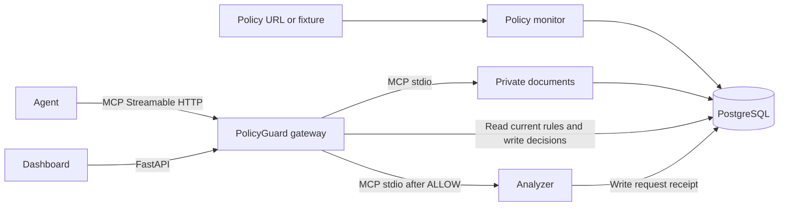

# Architecture

The FastAPI process hosts the dashboard API and the official SDK gateway. The dashboard demo uses an SDK client against the gateway ASGI endpoint. The CLI calls the same endpoint over TCP. Downstream servers use distinct SDK stdio sessions and preserve separation from the public MCP surface.

Monitoring normalizes text, hashes it, diffs against the latest stored version, and stores version, clause evidence and status in one transaction. Any changed snapshot requires review. The deterministic engine checks document and organization metadata, destination state, exact policy version approval, and the verified training condition. The analyzer owns its receipt records.

`db.py` defines storage, `monitor.py` handles policy observation, `engine.py` owns decisions, `gateway.py` orchestrates transfers, `downstream.py` hosts the two private servers, and `api.py` serves the dashboard and local administration.

## Phase 2

Two instances of the FastAPI codebase serve separate loopback endpoints and PostgreSQL databases. The dashboard assigns Demo and Live fixed API routes. The Live gateway uses the same SDK and transport as Demo and exposes a bounded analyze_document operation. Live configuration is loaded directly from its own settings file. The direct adapter stores authoritative observations for enforcement and the archive importer writes historical records to a separate table. A scheduler and manual refresh share one observation path.

A confidential Live request resolves to registered GitHub resource metadata. The gateway checks the current source policy and the approved local analyzer profile under the transfer lock, then uses private stdio to call GitHub MCP and the analyzer. The Live audit joins the transfer decision with resource and policy provenance.
